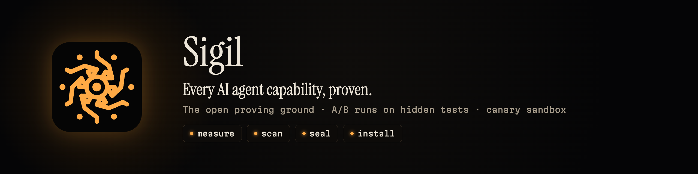

Sigil is the open proving ground for AI agent capabilities: skills, rules, commands, hooks, subagents
and MCP servers. It measures whether a capability actually makes a coding agent better, with A/B runs
scored by hidden tests, scans it for malicious behaviour in a canary sandbox, seals the exact content it
tested, and installs it into Claude Code, Codex, Cursor, Copilot, Gemini CLI, OpenCode and more from
one source.

| | |
| --- | --- |
| Code, issues and discussions | [github.com/dgesteves/sigil](https://github.com/dgesteves/sigil) |
| The observatory | [sigil-lab.vercel.app](https://sigil-lab.vercel.app) |
| How proof works | [Methodology](https://github.com/dgesteves/sigil/blob/main/spec/METHODOLOGY.md) |
| Contribute a capability or a task | [CONTRIBUTING.md](https://github.com/dgesteves/sigil/blob/main/CONTRIBUTING.md) |
| Report a malicious capability | [Security advisories](https://github.com/dgesteves/sigil/security/advisories/new) |

Sigil is pre-release. Results appear on the observatory only when real runs exist; nothing is shown as
proven until it is.

Built by [Diogo Esteves](https://github.com/dgesteves).
